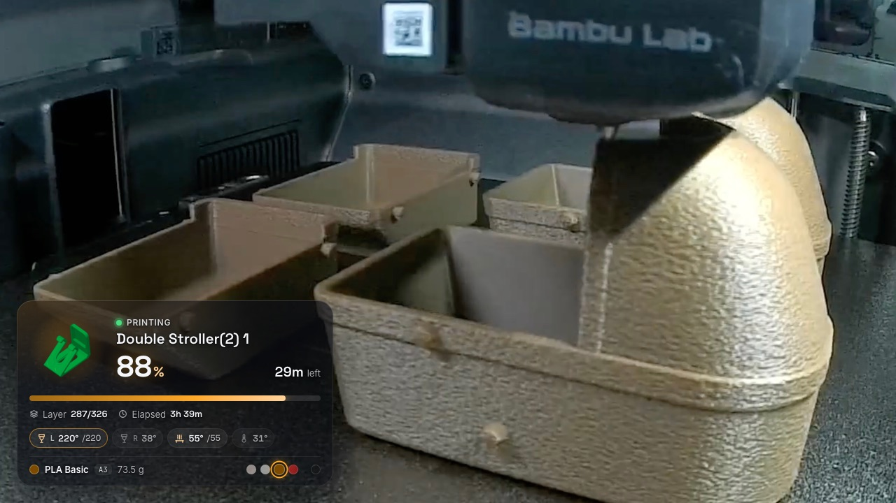
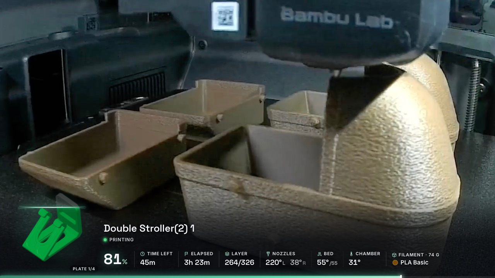
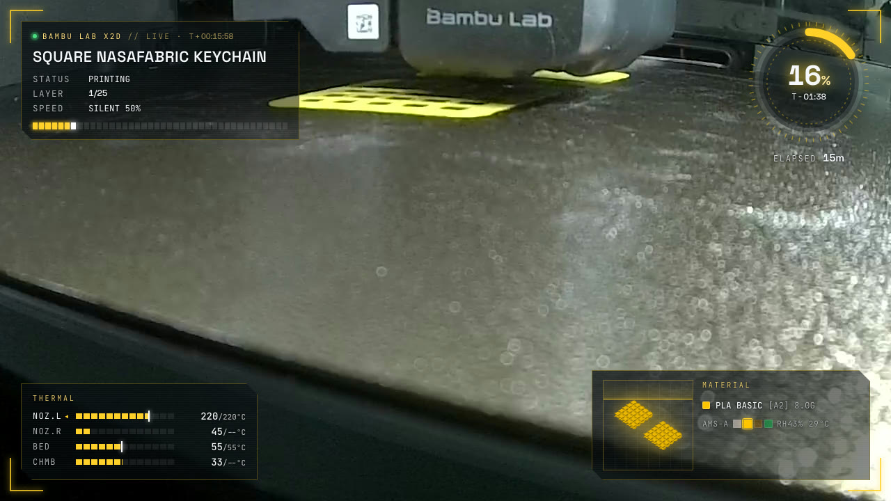
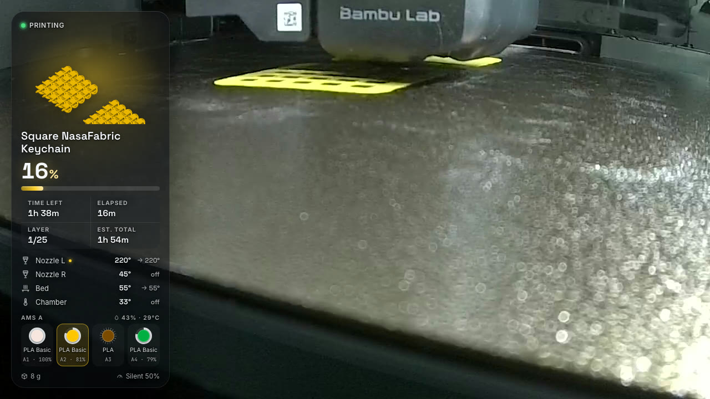
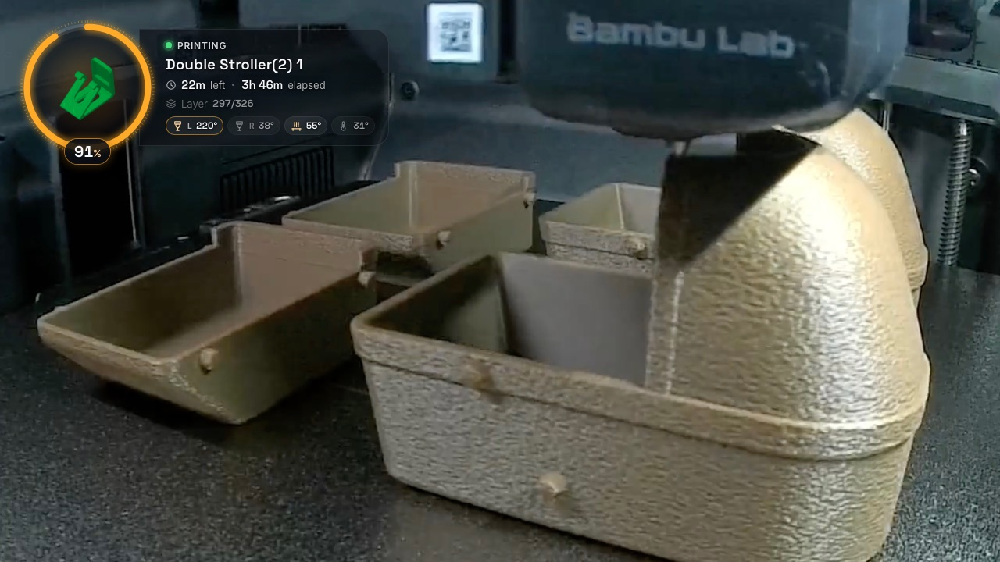
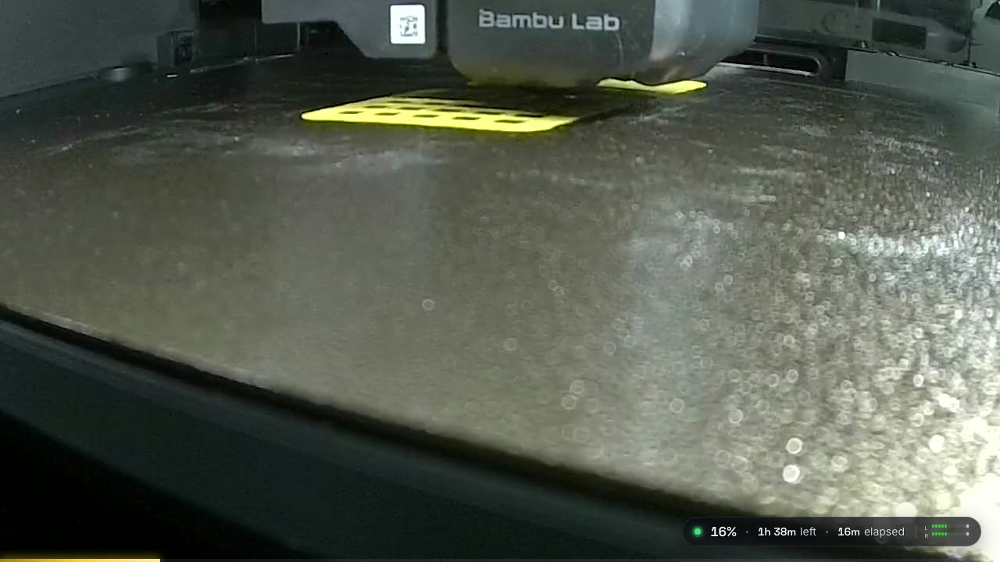

# Bambu X2D → OBS overlay

A locally hosted, transparent HTML overlay for streaming Bambu Lab X2D prints with OBS. It shows live job
progress, time left, elapsed time, layers, both nozzle temperatures, bed and chamber temperatures, the plate
preview rendered by the slicer, the filament in use and AMS slots (optionally also the model title, designer and
MakerWorld link). Six switchable layouts are included, and the accent colour follows the filament being printed.
It can also pan the camera crop in OBS smoothly when a print starts or ends.

No wall-clock times (ETA, clock) are shown on purpose: viewers are in other time zones, durations aren't.

| Glass | Lower third | HUD |
|---|---|---|
|  |  |  |
| **Sidebar** | **Orb** | **Minimal** |
|  |  |  |

*(Screenshots use demo data over a frame of the stream.)*

## Quick start

```bash
cp .env.example .env            # then fill in IP + access code (already done here)
./tools/build-app.sh            # builds "Bambu Overlay.app" (needs Xcode command line tools)
open "Bambu Overlay.app"        # menu-bar app that runs server.py; allow "local network" when asked
```

The app puts a printer icon in the menu bar with a status line, *Open Control Panel*, *Show Log*,
*Restart Server*, *Start at Login* and *Quit*. Server output goes to `cache/server.log`.

**Why an app?** macOS 15+ only lets a program reach devices on the local network (the printer) if there's an
app it can ask for permission. Run straight from a background terminal or tmux, `python3 server.py` gets a
silent `[Errno 65] No route to host`. Under the app, macOS asks once ("Bambu Overlay would like to find devices on
your local network") and remembers it. A foreground Terminal.app window works too, since Terminal gets the prompt.
Rebuilding the app changes its signature, so macOS may ask again.

`python3 server.py` (Python 3.10+, standard library only) still works anywhere the network isn't restricted.

| URL | What |
|---|---|
| `http://127.0.0.1:8787/` | **The overlay**: add it to OBS as a Browser source |
| `http://127.0.0.1:8787/control` | Control panel: layout, options, OBS crop, live previews, printer status |
| `http://127.0.0.1:8787/preview` | The overlay on top of a frame of the stream (accepts the same URL params) |
| `http://miniquest.local:8787/control` | The same from any device on your network (phone, tablet, second PC) |

The server listens on the whole local network by default (`OVERLAY_HOST=0.0.0.0`). Anyone on your LAN can open
the control panel and change overlay/crop settings, but nothing reaches the printer. Set `OVERLAY_HOST=127.0.0.1`
to keep it to this Mac.

### OBS

1. **Sources → + → Browser**, URL `http://127.0.0.1:8787/`, **Width 1280, Height 720** (1920×1080 works too:
   everything is laid out on a 1280×720 stage and scaled to fit).
2. Place it above the camera source and stretch it over the canvas. The page background is transparent.
3. Optional: **Docks → Custom Browser Docks** → add `http://127.0.0.1:8787/control` to switch layouts without leaving OBS.

The control panel changes every overlay that has no URL parameters. To pin a source to one look, add parameters,
e.g. one scene with `/?layout=hud` and another with `/?layout=minimal`:

| Param | Values | Default |
|---|---|---|
| `layout` | `glass` `ticker` `hud` `sidebar` `orb` `minimal` `none` | `glass` |
| `position` | `auto` `tl` `tr` `bl` `br` (glass / orb / minimal) | `auto` (glass bl, orb tl, minimal br) |
| `side` | `left` `right` (sidebar) | `left` |
| `scale` | `0.5`–`2` widget size | `1` |
| `accent` | `auto` (filament colour) or hex like `ff8800` | `auto` |
| `idle` | `show` / `hide` when nothing is printing | `show` |
| `name` | `file` (printer task / file name) / `title` (model title from the 3mf) | `file` |
| `ams` | `0` / `1`: AMS / filament slots | `1` |
| `credit` | `0` / `1`: designer + MakerWorld link | `0` |
| `meter` | `0` / `1`: Winamp-style L/R audio meter (needs the OBS WebSocket server) | `1` |
| `build` | `0` / `1`: the big lower-third model preview fills up layer by layer (unprinted part as a ghost) | `1` |
| `demo` | `1` simulate a print, `auto` simulate only when idle/offline | off |

The **lower third** puts a large model preview in the bottom-left corner, rising above the band, with the job name
above the stats row. As layers print, the preview turns from a pale ghost into the solid model, with a glowing line at
the current layer height. Layer count is used rather than time %, because it tracks physical height.

The **audio meter** is two segmented L/R bars in an old-Winamp style: LED segments going green→yellow→red,
peak caps that hold then fall, pixel-font labels. It sits at the bottom-right end of the lower third, in the glass
card and in the minimal pill. It's fed by OBS's `InputVolumeMeters` (20 frames/s, relayed by the server, so the OBS
password never reaches the browser) and shows the loudest **unmuted** input. Mute state is read from OBS and
followed live, so a muted backup source is ignored until you unmute it. A specific input can be picked in the
control panel. It's a beat visualiser, not a studio meter: bars are centred on the running average loudness and
scaled by its recent variation, so loud masters and quiet tracks both move.

The overlay hides itself if the printer has been unreachable for 90 s or the server stops. Paused jobs turn
amber and stopped/failed jobs turn red. Finished jobs show how long they took.

## OBS camera crop

The camera is cropped from 1920×1080 to 1280×720. The server pans that window over **obs-websocket** (built
into OBS 28+; enable it in **Tools → WebSocket Server Settings**):

| Printer | Crop (top / bottom) |
|---|---|
| Preparing, printing, paused | 80 / 280: higher up, toolhead and part |
| Idle, finished, stopped | 180 / 180: centred |

* Moves are eased over 2 s (adjustable 0–6 s). Values, mode (*Follow printer* / *Force printing* / *Force idle*)
  and an on/off switch are in the control panel. Keep top + bottom equal in both modes so the view pans without zooming.
* Only `cropTop`/`cropBottom` of scene items whose source is `OBS_SOURCE` (default `X2D`) change, in every scene
  that contains it. Left/right crop, position and bounds stay as set in OBS.
* It only moves when the target changes. Manual tweaks in OBS stay until the next print starts or ends, and if
  the printer is unreachable the crop is left alone.
* Connection details come from OBS's own WebSocket settings file (read at connect time, never copied or logged).
  Override them with `OBS_WS_URL` / `OBS_WS_PASSWORD` in `.env`, e.g. if OBS runs on another machine.

## Read-only by design

Nothing in this project can make the printer do anything. This is enforced in code, not by convention:

* **MQTT (TLS 8883)**: a minimal built-in client that can only send `CONNECT`, `SUBSCRIBE`
  (`device/<serial>/report`), `PINGREQ` and `DISCONNECT`. It has no publish code path, so it can't send
  even `pushall`; the X2D pushes a full status report every second on its own.
* **File channel (TLS 6000)**: the file-browser protocol Bambu Studio uses. Only `MEDIA_ABILITY` (7),
  `LIST_INFO` (1) and `FILE_DOWNLOAD` (4) are allowed; delete, upload or anything else raises before a byte is sent.
  It's used once per job to download the job's `.3mf` from internal storage (`/userdata/model/history/…`)
  for the plate preview, title, designer, filament grams and slicer estimate. Results are cached in `cache/`.
  The printer saves the job's copy a few seconds after the job starts, so a same-named file left over from an
  earlier print (for example another plate of the same project) is skipped: the server waits for a file that
  is newer than the job and contains the plate being printed.
* **SSDP (UDP 2021)**: passive listening only.
* FTPS (990) isn't used: on the X2D it only exposes external storage.
* The access code is only sent after the printer's TLS certificate CN matches the configured serial, so another
  device that takes over the old IP never receives it.

The tests check these guarantees (`python3 -m unittest -v`).

## Can the IP change?

Yes. The X2D gets its address from your router over DHCP (Wi-Fi, `wlan0`). Two safeguards:

1. **Automatic**: the printer broadcasts SSDP announcements with its serial number. The server listens, notices a new
   address for *your* serial, logs `printer … moved A -> B`, and reconnects.
2. **Recommended**: create a DHCP reservation (static lease) for the printer's MAC address in your router, so the
   IP in `.env` stays correct and other tools (Bambu Studio LAN mode, Home Assistant) keep working too.

## Resource usage

Built to run all day in the background:

| Part | CPU (Apple Silicon) | Memory |
|---|---|---|
| `server.py` (printer + OBS crop + meter relay, overlay connected) | ~0.5% | ~18 MB |
| menu-bar app | ~0.15% | ~15 MB |
| overlay page, lower third with live meter (headless Chrome, software rendering) | ~3% | |
| control panel with 7 previews open | ~4% | |

How it stays low:
* There are no endless repaint animations. The status dot "breathes" in 6 discrete steps, and the progress bar gloss is static.
* The audio meter redraws at 24 fps only while it's on screen and audio is moving. It stops completely when hidden,
  silent, or when the page isn't visible. The server doesn't relay repeated identical meter frames.
* Gallery thumbnails in the control panel are static (`?lite=1`: no animation, refreshed every 5 s).
* The printer pushes one status report a second. The 3MF model file is fetched once per job and cached.

For the absolute minimum, turn off the audio meter (`meter`) in the control panel.

## Configuration (`.env`)

| Key | |
|---|---|
| `BAMBU_X2D_IP` | Printer IP |
| `BAMBU_X2D_ACCESS_KEY` | LAN access code (printer screen → Settings → Network) |
| `BAMBU_X2D_SERIAL` | Optional; read from the printer's certificate if missing |
| `OVERLAY_HOST` / `OVERLAY_PORT` | Defaults `0.0.0.0:8787` (whole LAN); `127.0.0.1` = this Mac only |
| `OBS_SOURCE` | Camera source whose crop is animated (default `X2D`) |
| `OBS_WS_URL` / `OBS_WS_PASSWORD` | Optional; default to OBS's own WebSocket settings |

## Troubleshooting

* **`[Errno 65] No route to host` while `ping` works**: macOS is blocking local network access. Run the server via
  `Bambu Overlay.app` and allow it (System Settings → Privacy & Security → **Local Network** → *Bambu Overlay*).
* **OBS status "not reachable"**: OBS isn't running, or *Tools → WebSocket Server Settings → Enable* is off.
* **`printer rejected MQTT login`**: wrong access code, which changes if you toggle LAN mode on the printer.
* **No model preview**: the job file must be on the printer's internal storage (cloud and Bambu Studio sends put
  it there). `http://127.0.0.1:8787/control` shows the "Model data" status, and `python3 server.py -v` logs more.
* `GET /api/state` returns the processed state and `GET /api/raw` the merged raw printer report.

## Files

```
server.py            MQTT + file channel + SSDP + OBS crop + HTTP/SSE server (stdlib only)
tools/               menu-bar launcher app (BambuOverlay.swift) + build-app.sh
web/index.html       overlay templates (one <template> per layout)
web/overlay.css      layout styles
web/overlay.js       state → layout binding, demo data, accent colour
web/control.html     control panel
web/preview.html     overlay over a stream frame (web/preview-bg.jpg)
tests/test_server.py offline tests: parsing, read-only guarantees, crop animation against a fake OBS
cache/               settings, job start times, cached plate previews (safe to delete)
```

Data sources and field meanings were cross-checked against
[ha-bambulab](https://github.com/greghesp/ha-bambulab) (temperature packing, AMS slot encoding, stage names)
and verified against a live X2D (firmware 01.02.00.00).
